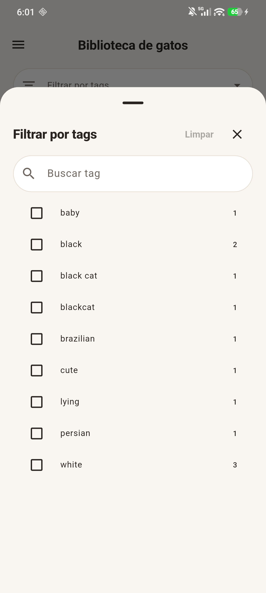
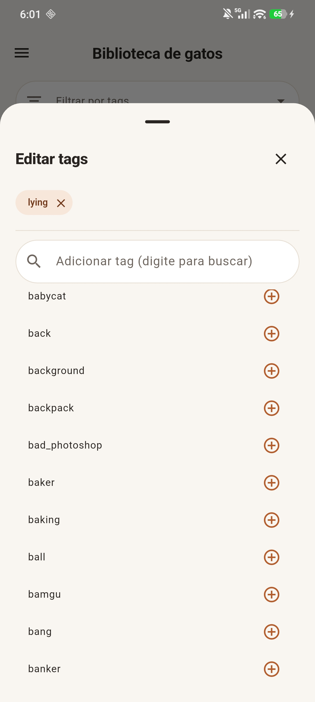

# Gatos

Aplicativo Flutter para descobrir e organizar fotos de gatos.

## Funcionalidades

- Cadastro, login e logout com Firebase Authentication.
- Login social com GitHub.
- Busca de gatos pela [CATAAS](https://cataas.com/), aleatória ou por tags.
- Interpretação de pedidos em linguagem natural com Gemini (opcional).
- Biblioteca pessoal sincronizada com Cloud Firestore.
- Filtros e edição de tags dos gatos salvos.
- Gato favorito usado como foto de perfil.

## Tecnologias

Flutter/Dart, Firebase Authentication, Cloud Firestore, CATAAS API e Gemini API.

## Como executar

Pré-requisitos: Flutter instalado e um projeto Firebase configurado para as
plataformas desejadas.

```bash
flutter pub get
flutter run
```

Para habilitar a busca por descrição, informe a chave do Gemini sem gravá-la no
código:

```bash
flutter run --dart-define=GEMINI_API_KEY=sua_chave
```

O ponto de entrada está em [`lib/main.dart`](lib/main.dart). As telas ficam em
[`lib/screens`](lib/screens), os serviços em [`lib/services`](lib/services) e
os componentes reutilizáveis em [`lib/components`](lib/components).

## Telas do aplicativo

### Criar conta

Cadastro de um novo usuário no aplicativo.


### Logar

Tela de login para acessar uma conta existente.


### Menu

Menu principal com acesso à descoberta e à biblioteca de gatos.


### Buscar por tags com Gemini

Busca de gatos usando uma descrição interpretada pelo Gemini.


### Filtrar por tags

Filtragem dos gatos salvos na biblioteca por tags.



### Editar tags

Edição das tags associadas a um gato salvo.



### Definir gato favorito

Seleção de um gato salvo como favorito e foto de perfil.


### Excluir gato

Confirmação da exclusão de um gato da biblioteca.


