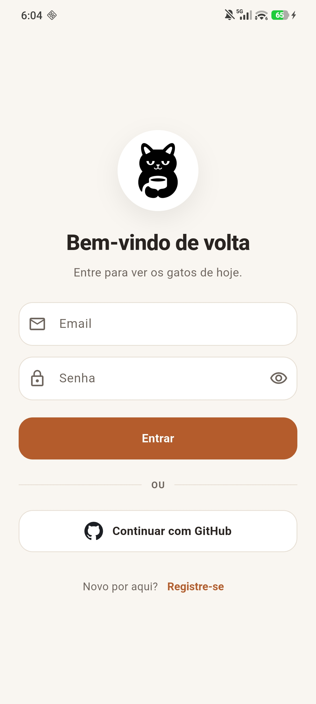
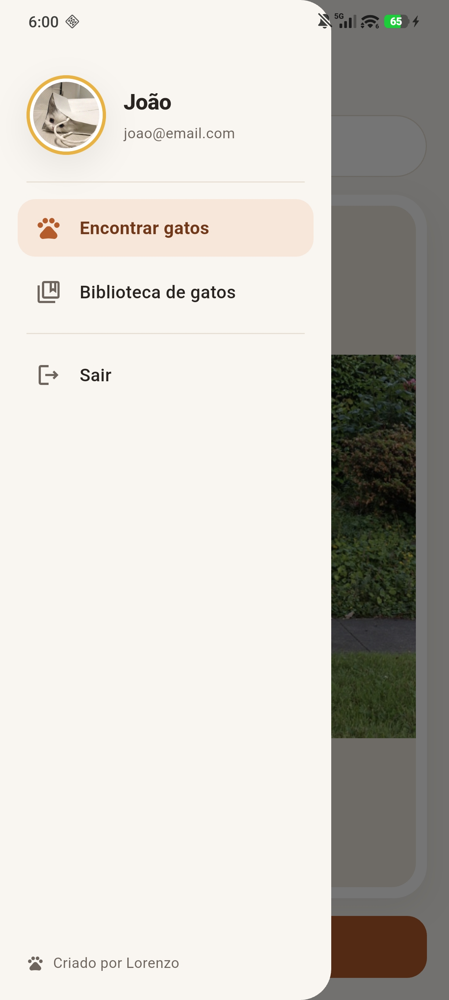
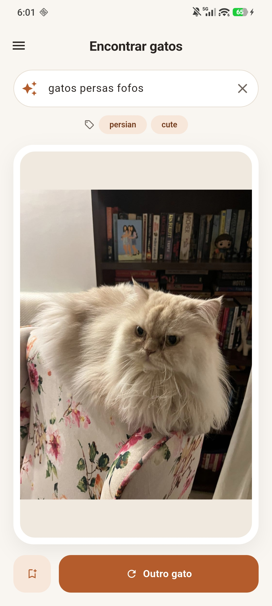
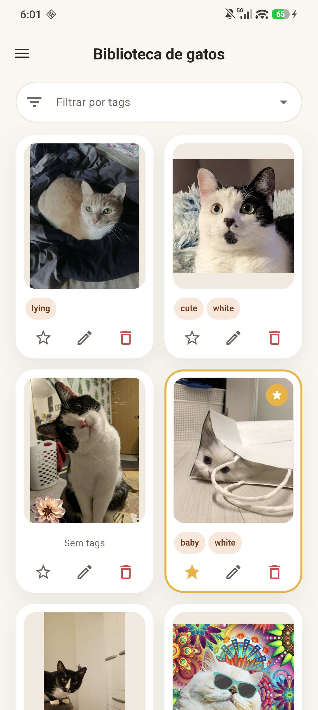
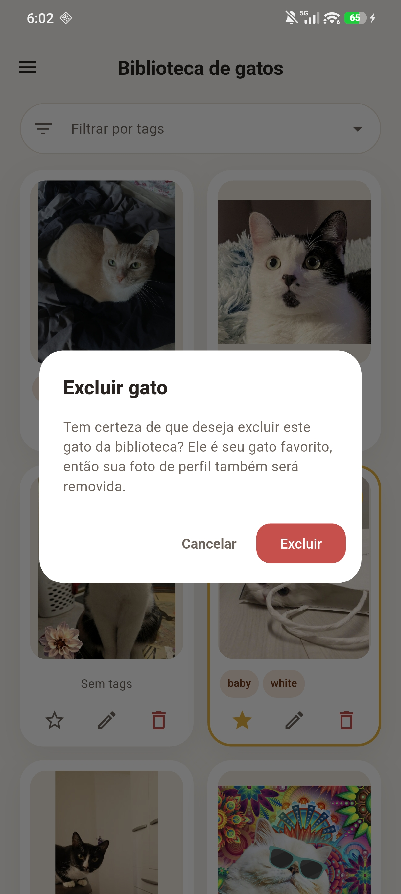

# Gatos

Aplicativo Flutter para descobrir e organizar fotos de gatos.

## Funcionalidades

- Cadastro, login e logout com Firebase Authentication.
- Login social com GitHub.
- Busca de gatos pela [CATAAS](https://cataas.com/), aleatória ou por tags.
- Interpretação de pedidos em linguagem natural com Gemini (opcional).
- Biblioteca pessoal sincronizada com Cloud Firestore.
- Filtros e edição de tags dos gatos salvos.
- Gato favorito usado como foto de perfil.

## Tecnologias

Flutter/Dart, Firebase Authentication, Cloud Firestore, CATAAS API e Gemini API.

## Como executar

Pré-requisitos: Flutter instalado e um projeto Firebase configurado para as
plataformas desejadas.

```bash
flutter pub get
flutter run
```

Para habilitar a busca por descrição, informe a chave do Gemini sem gravá-la no
código:

```bash
flutter run --dart-define=GEMINI_API_KEY=sua_chave
```

O ponto de entrada está em [`lib/main.dart`](lib/main.dart). As telas ficam em
[`lib/screens`](lib/screens), os serviços em [`lib/services`](lib/services) e
os componentes reutilizáveis em [`lib/components`](lib/components).

## Telas do aplicativo

As principais telas estão organizadas abaixo em uma grade compacta:

| Criar conta<br><sub>Cadastro de usuário</sub> | Logar<br><sub>Acesso à conta</sub> |
|---|---|
|  |  |

| Menu<br><sub>Navegação principal</sub> | Buscar por tags com Gemini<br><sub>Busca por descrição</sub> |
|---|---|
|  |  |

| Filtrar por tags<br><sub>Filtro da biblioteca</sub> | Editar tags<br><sub>Edição de tags salvas</sub> |
|---|---|
|  |  |

| Definir gato favorito<br><sub>Foto de perfil</sub> | Excluir gato<br><sub>Remoção da biblioteca</sub> |
|---|---|
|  |  |
